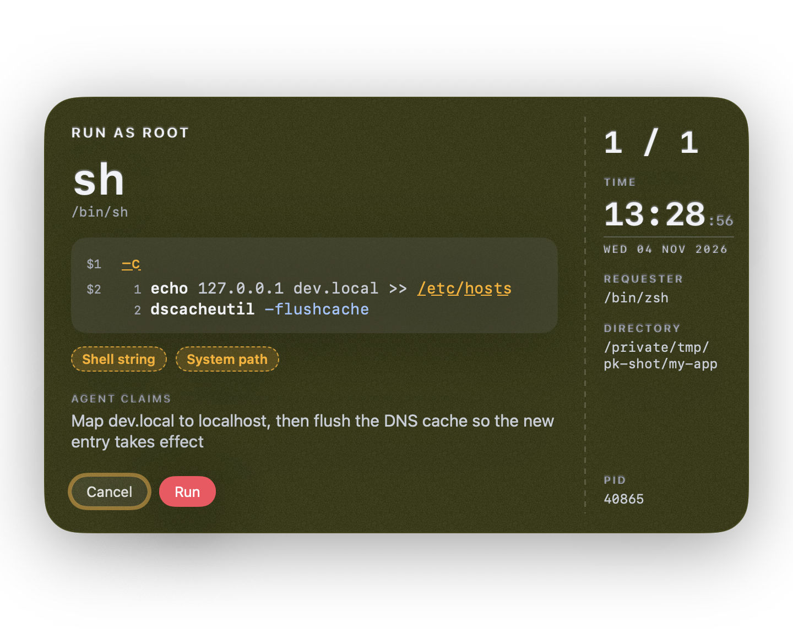

# letmedo

Let an AI agent ask for root, and let a human decide.



```sh
letmedo -m "Flush the DNS cache so the new hosts entry takes effect" dscacheutil -flushcache
```

The agent runs `letmedo` with a reason. A window shows you the exact command, the agent's reason, which program asked, its working directory, and the time of the request. It flags recursive deletes, shell `-c` strings, and system paths. When several requests arrive at once, they queue as a stack and you answer them one at a time. You approve with Touch ID, or with your password when Touch ID is unavailable. The command's output and exit code go back to the agent. The agent never sees your password and never keeps root afterwards.

## Requirements

- macOS 26 or later
- Swift 6 (Command Line Tools are enough)
- Touch ID for sudo, enabled in `/etc/pam.d/sudo_local`:

  ```sh
  sudo sh -c 'sed "s/^#auth/auth/" /etc/pam.d/sudo_local.template > /etc/pam.d/sudo_local'
  ```

## Build

```sh
make test
make build    # writes the binary to `swift build -c release --show-bin-path`
make install  # builds, then copies the binary to ~/.local/bin/letmedo
```

The linker signs the binary ad hoc. It has no Team ID and is not notarized, so build it yourself and run it only on your own Mac. Check the signature with `codesign -dv ~/.local/bin/letmedo`, which reports `Signature=adhoc`.

## Usage

```sh
letmedo [-m message] <command> [args...]
```

- `-m message` is the agent's reason. The window labels it as a claim.
- `<command>` is resolved through `PATH` to an absolute path, and the window shows that path.
- `letmedo --skill` prints an agent skill that explains how to use `letmedo`. Install it with `letmedo --skill > ~/.claude/skills/letmedo/SKILL.md`.

## How it works

1. `letmedo` resolves the command and shows the confirm window.
2. On approval, it asks sudo to authenticate with Touch ID.
3. If Touch ID fails, it shows its own password window and passes your password to sudo as its askpass helper.
4. It runs the command through `sudo -n`, then drops the sudo credential at once.

## What it protects against

`letmedo` is for an honest agent that may be careless. It shows you exactly what will run, keeps your password away from the agent, and leaves no sudo credential behind.

- The displayed argv escapes invisible characters, so a right-to-left override or an ANSI escape cannot hide part of the command.
- The execute button does not respond to Return, and unlocks 0.6s after its window reaches the front. Tab and Space can reach it, because Touch ID or the password still gates the run.
- The sudo credential is keyed to the `letmedo` process, so another process cannot reuse it while the command runs.

`letmedo` does not protect you from a malicious agent. An agent running as you can draw a lookalike window, and it can run `sudo -v` itself, which shows the same Touch ID prompt with no command attached. Approve a Touch ID prompt only right after a `letmedo` window you have read.
